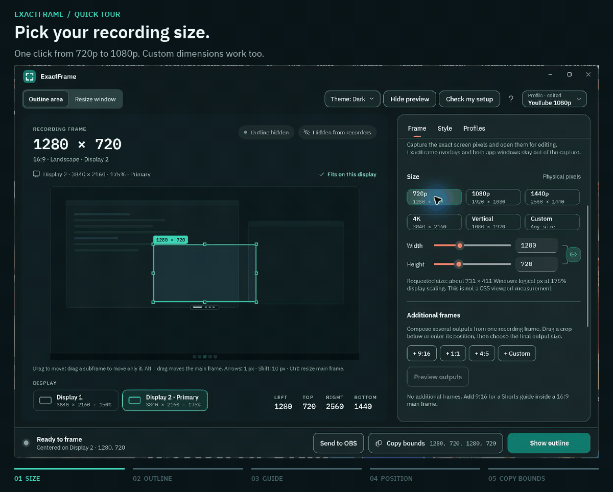

# ExactFrame

**Get the frame right. Then hit Record.**

Stop guessing where your screen recording starts and ends. ExactFrame gives you a precise outline, sizes your app to fit, and helps you plan landscape, square and vertical shots before you record.

**[Download for Windows →](https://github.com/MaxAkbar/ExactFrame/releases/tag/v2.3.0)** · [Quick start](#your-first-frame) · [Keyboard shortcuts](#handy-shortcuts) · [Get help](#need-a-hand)

*Portable · Windows 10 / 11 · x64 and ARM64 · No installer required*

[](docs/media/exactframe-overview.png)

*A quick tour of the actual app. [View a still image](docs/media/exactframe-overview.png). ExactFrame prepares the shot; OBS Studio or your usual recorder captures the video.*

## What can you do with it?

| Your next recording | How ExactFrame helps |
|---|---|
| **A crisp tutorial or product demo** | Pick 720p, 1080p, 1440p, 4K or your own dimensions. See exactly where the capture area begins and ends. |
| **A browser or app walkthrough** | Resize the whole window, its client area or a supported browser's visible web page to your requested size. |
| **One take, several formats** | Add 9:16, 1:1 or 4:5 guides inside the main frame and position them around the content that matters. |
| **The same setup tomorrow** | Save your size, display, position and appearance as a profile, then bring it back with a shortcut. |

## Download and go

Choose your **ExactFrame 2.3.0** download:

| Your PC | Portable download |
|---|---|
| **Most Windows PCs** — Intel or AMD, 64-bit | **[Download x64 ZIP](https://github.com/MaxAkbar/ExactFrame/releases/download/v2.3.0/ExactFrame-2.3.0-win-x64-portable.zip)** |
| **Windows on Arm** | [Download ARM64 ZIP](https://github.com/MaxAkbar/ExactFrame/releases/download/v2.3.0/ExactFrame-2.3.0-win-arm64-portable.zip) |

Extract the ZIP and open **ExactFrame.exe**. No separate .NET installation is needed, and PowerToys is optional.

Requires **Windows 10 version 1809 or later**; Windows 11 is recommended. Downloads are currently unsigned, so Windows may show an unknown-publisher warning. The [release page](https://github.com/MaxAkbar/ExactFrame/releases/tag/v2.3.0) includes known limitations and `SHA256SUMS.txt` for checking your download.

## Your first frame

1. **Choose a size.** Select **Outline area**, then **1080p** or your own width and height.
2. **Place the shot.** Pick a display under the preview. Drag the frame in the preview, or use the position grid to center it.
3. **Show the outline.** Select **Show outline** or press **Ctrl + Alt + F8**, then arrange your content inside the border.
4. **Set your recorder's region.** Select **Copy bounds** and use the X, Y, width and height values in your recorder's region or crop settings.
5. **Check a short test clip.** Confirm the framing before recording the full take.

Want a vertical version too? Under **Frame → Additional frames**, select **+ 9:16** and drag the guide in the preview. **Copy bounds** includes the main frame and any additional guides. [Explore output compositions →](docs/output-compositions.md)

> **Before you record:** **Hide from recorders** asks Windows to exclude the outline and floating controls from captures. It needs Windows 10 version 2004 or later and a compatible capture method. Check your saved clip; if the outline appears, hide it with **Ctrl + Alt + F8**. Move or minimize the main ExactFrame window if it is inside the shot.

## Make a window fit

Select **Resize window**, choose an app from the list or use **Pick on screen**, and enter your target size. Choose what to measure:

| Mode | What your requested size includes |
|---|---|
| **Client area** | The app's content below its title bar. In a browser, this includes the toolbar. |
| **Whole window** | The entire window, including its borders and title bar. |
| **Web page** | The visible page in a supported browser such as Chrome or Edge, with tabs and toolbars outside the frame. |

Select **Resize window** to apply it. ExactFrame measures the result and reports whether the app reached the exact size or accepted a nearby size. Some apps enforce minimum sizes or round their dimensions.

The outline follows the app as you move it, including between displays. **Restore original size** returns it to its size and position before the first resize in that session. ExactFrame can automatically reapply an app's remembered size; use **Forget size** to stop this.

## Make it your own

- **Draw the region you need.** Use **Draw on screen**, start with **Use window bounds**, or adjust the frame with drag handles and precise keyboard nudges. [Frame editing guide →](docs/direct-frame-editing.md)
- **Choose a look.** In **Style**, change colors, line weights, dashed or corner borders, dimming and composition guides. **Theme** switches the app between System, Light and Dark.
- **Save a favorite setup.** In **Profiles**, save a size, position, display and mode, optionally with its appearance. [Move profiles to another PC →](docs/portable-profiles.md)
- **Keep controls within reach.** Use the floating bar for quick adjustments. Enable **Click-through** to pass clicks through the border, or collapse the preview for a smaller workspace. [More workspace options →](docs/usability-and-engineering.md)

## Handy shortcuts

| Shortcut | Action |
|---|---|
| **Ctrl + Alt + F8** | Show or hide the outline |
| **Ctrl + Alt + F9** | Toggle click-through |
| **Ctrl + Alt + F10** | Apply the next profile |
| **Ctrl + Alt + 1–9** | Apply the profile assigned to that slot |
| **F1** | Open Help |
| **Esc** | Cancel an active drag, close Help or hide the outline while ExactFrame has focus |

These are the defaults. See your active assignments in **Help → Keyboard shortcuts** and change them in **Profiles → Global hotkeys**. ExactFrame flags conflicts with other apps and avoids assignments that interfere with AltGr typing.

## Connect your workflow

| Tool | What you can do |
|---|---|
| **OBS Studio** | Preview and apply a frame to a Display Capture source, with undo. [Send to OBS →](docs/obs-integration.md) |
| **SnapStudio 1.2.0+** | Capture the exact frame as a still image and open it for editing. [Capture in SnapStudio →](docs/snapstudio-integration.md) |
| **PowerToys** *(optional)* | Use Workspaces launch commands, FancyZones profile links and timed Awake sessions. A separate Command Palette development companion is also available. [PowerToys setup →](docs/powertoys-integration.md) |

See [what's new in 2.3.0](docs/releases/v2.3.0.md).

## Need a hand?

Press **F1** or select **?** for searchable help. **Check my setup** walks through recording checks; the [compatibility guide](docs/recording-compatibility.md) lists completed checks and remaining limitations.

<details>
<summary><strong>Are the dimensions affected by Windows scaling?</strong></summary>

A **1920 × 1080** frame always means 1920 × 1080 **physical screen pixels**, even at 150% or 200% Windows scaling. The colored border sits inside the frame; its outer edges mark the capture area. The frame must fit on one display. ExactFrame explains an oversized request instead of silently shrinking it.

Browser CSS pixels, page zoom and device-pixel ratio are different measurements. See the [browser sizing guide](docs/browser-sizing.md).

</details>

<details>
<summary><strong>Why is ExactFrame still running after I close the window?</strong></summary>

By default, closing the window keeps ExactFrame in the notification area so the outline and shortcuts stay available. Right-click its icon and choose **Quit ExactFrame** to exit. If you enable **Start with Windows**, keep the executable in a stable folder.

</details>

<details>
<summary><strong>Where are my settings, and how do I report a problem?</strong></summary>

Settings, profiles and remembered app sizes are stored at `%LOCALAPPDATA%\ExactFrame\exactframe.db`. Use **Help → About → Open settings folder** to find it.

For a bug report, select **Help → About → Copy system info**, then [open an issue](https://github.com/MaxAkbar/ExactFrame/issues). Include what you tried and what happened. For recording problems, include your recorder, capture method and display scaling. If several app windows look alike, the [application matching guide](docs/application-targeting.md) can help you target the right one.

</details>

## Build from source

On Windows, install the **.NET 10 SDK** specified in [global.json](global.json), then run:

```powershell
dotnet restore ExactFrame.slnx -p:Platform=x64 --locked-mode
dotnet run --project src/ExactFrame/ExactFrame.csproj -p:Platform=x64 --no-restore
```

For ARM64, use `-p:Platform=ARM64`. You can also open `ExactFrame.slnx` in Visual Studio with the **WinUI application development** workload.

See the [development guide](docs/development.md) for tests, portable builds, project layout and Windows checks.
